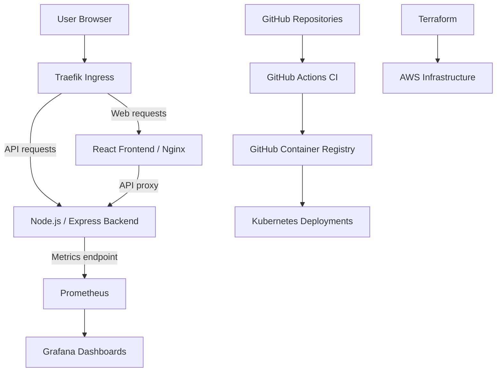


# Zuri Platform — DevOps Capstone

## Overview

Zuri Platform is the infrastructure, deployment automation, security, and monitoring repository for the Zuri e-commerce application.

The project demonstrates practical DevOps engineering using Docker, Kubernetes, GitHub Actions, Terraform, AWS infrastructure configuration, Prometheus, and Grafana.

The application is divided into three GitHub repositories:

- **Backend:** [zuriapp-backend](https://github.com/walesplus/zuriapp-backend)
- **Frontend:** [zuriapp-frontend](https://github.com/walesplus/zuriapp-frontend)
- **Platform:** [zuri-platform](https://github.com/walesplus/zuri-platform)

## Architecture



The application runs on a local Docker Desktop Kubernetes cluster. Terraform configurations are maintained separately for AWS infrastructure provisioning.

## Technology Stack

| Category | Technology |
|---|---|
| Frontend | React, Vite, Nginx |
| Backend | Node.js, Express |
| Containers | Docker |
| Container registry | GitHub Container Registry |
| Container orchestration | Kubernetes |
| Ingress controller | Traefik |
| CI/CD | GitHub Actions |
| Infrastructure as Code | Terraform |
| Cloud infrastructure | AWS |
| Metrics | Prometheus |
| Dashboards | Grafana |
| Security scanning | Trivy |

## Containerization

The frontend and backend use Docker images published to GitHub Container Registry.

Backend image:

`ghcr.io/walesplus/zuriapp-backend:1.2`

Frontend image:

`ghcr.io/walesplus/zuriapp-frontend:21e38bedaf3e4dbff305d121f55103bd9f3c06bf`

Docker security controls include non-root execution and minimized runtime dependencies.

## Kubernetes Deployment

The Zuri application runs in the `zuri` namespace.

Resources include:

- Backend Deployment and Service
- Frontend Deployment and Service
- ConfigMaps for application configuration
- Kubernetes Secret for the backend API key
- Traefik ingress routing

The frontend serves traffic on container port 8080, while the backend listens on port 5000.

### Health Checks and Reliability

The backend uses:

- Startup probe: `/api/health`
- Readiness probe: `/api/health`
- Liveness probe: `/api/health`

The frontend uses HTTP health probes against `/` on port 8080.

Both deployments use rolling-update strategies with `maxSurge: 1` and `maxUnavailable: 0`.

CPU and memory requests and limits are configured for both application containers.

### Verify Deployments

```bash
kubectl -n zuri get deployments,pods,services
kubectl -n zuri rollout status deployment/zuri-backend
kubectl -n zuri rollout status deployment/zuri-frontend
```

## CI/CD Pipeline

GitHub Actions performs automated validation of platform changes.

The platform CI workflow includes:

1. Docker Compose integration testing.
2. Terraform formatting and validation.
3. Trivy filesystem, vulnerability, misconfiguration, and secret scanning.

Backend CI includes application tests and linting, with Docker build validation.

Changes are developed on feature branches and merged through GitHub pull requests after successful checks.

## Security Controls

Security practices implemented in the project include:

- Non-root container execution.
- Read-only container root filesystems.
- Disabled privilege escalation.
- Dropped Linux capabilities.
- Kubernetes Secret management for sensitive API configuration.
- Container image scanning.
- Terraform security checks.
- Restricted infrastructure access configurations.
- IMDSv2 requirements for AWS EC2 configuration.
- Encrypted EC2 root volumes.

The project includes a documented temporary Terraform egress exception for local capstone infrastructure requirements.

## Monitoring and Observability

Prometheus collects application and Kubernetes metrics.

The Zuri backend exposes:

- `/metrics` — Prometheus metrics
- `/api/health` — Application health
- `/api/store` — Store information
- `/api/products` — Product catalogue

Prometheus scrapes the backend through the Kubernetes Service:

`zuri-backend-service.zuri.svc.cluster.local:5000`

### Prometheus

Install using the repository's Helm values:

```bash
helm upgrade --install prometheus \
  prometheus-community/prometheus \
  --namespace monitoring \
  --create-namespace \
  -f monitoring/prometheus/values.yaml
```

Access Prometheus:

```bash
kubectl -n monitoring port-forward service/prometheus-server 9090:80
```

Open http://localhost:9090.

Verify the backend target:

```promql
up{namespace="zuri",service="zuri-backend-service"}
```

A result of `1` indicates successful scraping.

### Grafana

The repository contains three Grafana dashboard definitions:

1. Zuri Backend Error Rate
2. Zuri Backend Response Time
3. Zuri Monitoring Target Health

Create or update the dashboard ConfigMap:

```bash
kubectl -n monitoring create configmap zuri-grafana-dashboards \
  --from-file=monitoring/grafana/dashboards/ \
  --dry-run=client -o yaml | kubectl -n monitoring apply -f -
```

Install Grafana:

```bash
helm upgrade --install grafana \
  grafana-community/grafana \
  --namespace monitoring \
  -f monitoring/grafana/values.yaml
```

Access Grafana:

```bash
kubectl -n monitoring port-forward service/grafana 3005:80
```

Open http://localhost:3005.

The dashboards are provisioned from Kubernetes ConfigMaps, with Prometheus configured as the default datasource.

## Terraform and AWS

The `terraform/` directory contains infrastructure-as-code configurations for AWS resources, including EC2 and networking.

Terraform validation:

```bash
cd terraform
terraform init -backend=false
terraform fmt -check -recursive
terraform validate
```

AWS infrastructure configuration is separate from the currently demonstrated local Kubernetes deployment.

## Repository Structure

```text
zuri-platform/
├── .github/
│   └── workflows/
├── k8s/
│   ├── backend/
│   ├── frontend/
│   └── ingress.yaml
├── monitoring/
│   ├── prometheus/
│   │   └── values.yaml
│   └── grafana/
│       ├── values.yaml
│       └── dashboards/
├── scripts/
├── terraform/
├── docker-compose.yml
└── README.md
```

## Local Deployment Verification

Check application workloads:

```bash
kubectl -n zuri get pods,services
```

Check monitoring workloads:

```bash
kubectl -n monitoring get pods,services
```

Check Traefik:

```bash
kubectl -n traefik get pods,services
```

To access the application through Traefik locally:

```bash
kubectl -n traefik port-forward service/traefik 8090:80
```

Open http://localhost:8090.

## Project Outcomes

This capstone demonstrates hands-on experience in:

- Containerizing full-stack applications.
- Implementing automated CI validation and security scanning.
- Deploying and managing Kubernetes workloads.
- Configuring ingress and internal service communication.
- Managing infrastructure with Terraform.
- Implementing Prometheus monitoring and Grafana dashboards.
- Troubleshooting application startup, image compatibility, health probes, and Kubernetes rollouts.
- Using Git feature branches and pull requests for infrastructure changes.

## Future Improvements

- Automated Kubernetes deployment following successful CI checks.
- Persistent monitoring storage.
- Centralized application logging.
- Alerting and notification workflows.
- Additional automated integration and recovery tests.
- A complete production-oriented cloud deployment.
